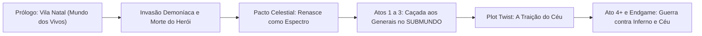
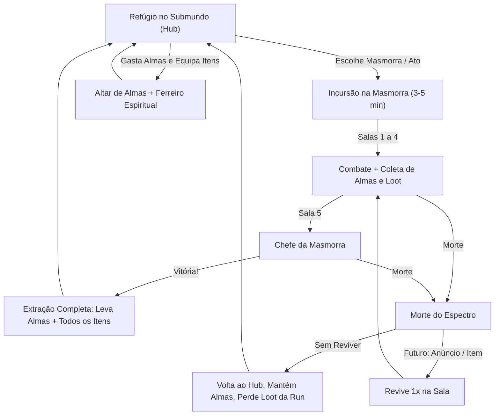

# 📜 SUBMUNDO — Game Design Document (GDD v1.0)

> **Título do Projeto:** SUBMUNDO  
> **Gênero:** Action RPG Roguelite / Dungeon Crawler  
> **Plataformas:** Web Browser (Desktop & Mobile) e futuro empacotamento Mobile Nativo  
> **Estilo Visual:** Híbrido — Gameplay em Pixel Art Dark Fantasy (16/32-bit) + Retratos, Diálogos e Ícones de Loot em Arte 2D Estilizada  
> **Stack Técnica:** TypeScript + Phaser 3 + Vite (Arquitetura Desacoplada `core` / `view`)

---

## 📖 Índice

1. [Visão Geral e Pitch](#1-visão-geral-e-pitch)
2. [História, Lore e Estrutura de Mundo](#2-história-lore-e-estrutura-de-mundo)
3. [Loop Central de Gameplay e Controles](#3-loop-central-de-gameplay-e-controles)
4. [Combate, Classes e Sinergias Elementais](#4-combate-classes-e-sinergias-elementais)
5. [Sistema de Loot, Equipamentos e Progressão](#5-sistema-de-loot-equipamentos-e-progressão)
6. [Modos de Jogo e Retenção (Endgame)](#6-modos-de-jogo-e-retenção-endgame)
7. [Direção de Arte, Câmera e UI Responsiva](#7-direção-de-arte-câmera-e-ui-responsiva)
8. [Monetização Ética (Futuro)](#8-monetização-ética-futuro)
9. [Arquitetura Técnica (Preparada para Futuro 3D)](#9-arquitetura-técnica-preparada-para-futuro-3d)
10. [Roadmap de Desenvolvimento em Fases](#10-roadmap-de-desenvolvimento-em-fases)

---

## 1. Visão Geral e Pitch

**O Pitch em uma frase:**  
*"Um Action RPG sombrio de bolso onde um guerreiro morto é transformado em Espectro para caçar os Generais do Inferno em masmorras rápidas de 3 a 5 minutos — até descobrir que o próprio Céu o está usando."*

### Pilares de Design
- **Sessões Curtas, Profundidade Longa:** Masmorras rápidas de 3 a 5 minutos (4 salas + 1 Boss), perfeitas para jogar no celular ou no navegador, mas com builds profundas dignas de *Diablo*.
- **Alto Risco e Recompensa:** Morrer na masmorra faz você voltar ao Hub com as **Almas** coletadas, mas perdendo os equipamentos não segurados daquela descida (com opção futura de reviver uma vez).
- **Escopo Inteligente (Solo Dev + IA):** Um único Hub evolutivo, geração procedural guiada por JSON e separação total entre lógica (`core`) e visual (`view`).

---

## 2. História, Lore e Estrutura de Mundo



### Ato 0 — O Prólogo (Mundo dos Vivos)
- **Quem você é:** Um jovem guerreiro comum em treinamento em sua pacata vila natal.
- **O Hub Inicial (A Vila):** Pequena e viva, com seu Mestre de Armas, um Ferreiro simples, uma Vendedora de Poções e moradores locais.
- **As Primeiras Masmorras:** Tarefas locais que servem de tutorial natural:
  1. *A Gruta da Cachoeira* (teste do Mestre contra slimes e morcegos).
  2. *A Mina Abandonada* (limpar esqueletos que surgiram à noite).
  3. *OSelo Antigo* (no fundo da mina, uma porta ancestral se rompe).
- **A Tragédia:** Uma horda liderada por um General do Abismo emerge da fenda e incendeia a vila. Você luta ao lado do seu Mestre, mas é derrotado e morto.

### O Despertar no SUBMUNDO
- Antes que sua alma desapareça, um **Emissário Celestial (Anjo)** intervém. Pelas leis antigas, seres celestiais não podem pisar no Submundo sem iniciar o Apocalipse.
- O Anjo crava um **Selo Celestial** em sua alma, transformando você em um **Espectro Caçador**, preso no **SUBMUNDO** com uma missão: *"Destrua os Generais do Inferno que preparam a invasão à Terra e eu devolverei sua vida."*
- **O Hub Definitivo (O Refúgio do Submundo):** As ruínas espelhadas da sua própria vila arrastadas para o Submundo, iluminadas por chamas espirituais azuis. Lá ficam o Emissário Celestial, a alma do Ferreiro da sua vila e outros espíritos aliados.

### A Grande Virada (Atos Avançados)
- Conforme você derrota os Generais do Inferno e absorve o poder deles, descobre a verdade: **a facção Celestial permitiu o massacre da sua vila de propósito** para alimentar suas fornalhas de almas e justificar o expurgo da humanidade.
- Você rompe o controle do Selo e passa a enfrentar tanto as legiões do **Inferno** quanto os inquisidores e serafins do **Céu**.

---

## 3. Loop Central de Gameplay e Controles



### Controles Híbridos (Mobile & Web)
- **Movimentação:** Joystick virtual flutuante no celular (jogue com 1 polegar) / `WASD` ou Setas no PC.
- **Ataque Básico:** **Automático** contra o inimigo mais próximo dentro do alcance da arma equipada, permitindo que o jogador foque em posicionamento e esquiva.
- **Ações Ativas (3 Botões):**
  1. **Esquiva Espectral (Dash):** Atravessa inimigos e projéteis com invulnerabilidade curta (cooldown ~3s).
  2. **Habilidade Ativa 1:** Skill escolhida pelo jogador (cooldown ~6-10s).
  3. **Habilidade Ativa 2:** Skill pesada/suprema escolhida pelo jogador (cooldown ~12-18s).
  4. **Poção de Alma:** Cura instantânea com cargas limitadas que recarregam no Hub.

---

## 4. Combate, Classes e Sinergias Elementais

### Evolução de Classes
- **Prólogo e Ato 1:** Foco 100% no **Guerreiro Espectral** (combate corpo a corpo visceral, espadas, machados e foices).
- **Ato 2 em diante (No Submundo):** O jogador desbloqueia novas **Formas de Espectro (Classes)** no Hub:
  - ⚔️ **Guerreiro / Ceifador:** Corpo a corpo, impacto, sangramento e chamas.
  - 🏹 **Caçador das Sombras:** Adagas e projéteis rápidos, veneno, armadilhas e crítico.
  - 💀 **Conjurador do Abismo (Necromante):** Invocação de esqueletos espectrais e magias de área.
  - ⚡ **Paladino Caído:** Lança, escudo e luz celestial corrompida.

### As 3 Forças do Submundo (Sinergias de Build)
Todo equipamento especial e modificador de skill pertence a uma das 3 forças:

| Força | Elemento / Temática | Mecânica Chave | Exemplo de Efeito Lendário |
| :--- | :--- | :--- | :--- |
| 🔥 **Inferno** | Cinzas e Fogo Abissal | **Brasa:** Acumula queimaduras que explodem em área ao atingir 5 cargas. | *"Seu Dash deixa um rastro de fogo infernal que aplica Brasa."* |
| 🩸 **Submundo** | Sangue e Sombra | **Sangramento & Roubo de Vida:** Dano contínuo que cura o Espectro. | *"Inimigos que morrem sangrando têm 25% de chance de virar um servo espectral."* |
| ⚡ **Empíreo** | Luz Celestial Corrompida | **Julgamento & Raio:** Críticos disparam raios em cadeia e atordoam. | *"Acertos críticos soltam um raio celestial nos 2 inimigos mais próximos."* |

---

## 5. Sistema de Loot, Equipamentos e Progressão

### Os 6 Slots de Equipamento (Grade 2×3)
1. **Arma (`weapon`):** Define poder de ataque, velocidade, alcance e formato do ataque básico.
2. **Armadura (`armor`):** Define Vida Máxima, Armadura/Defesa e Resistência.
3. **Elmo (`helm`):** Focado em Armadura, Vitalidade e Chance Crítica.
4. **Bota (`boots`):** Focada em Armadura, Velocidade de Movimento e Redução de Cooldown.
5. **Amuleto / Selo (`amulet`):** Focado em Vida Máxima, Cooldown e modificadores das Skills Ativas.
6. **Anel de Alma (`ring`):** Focado em Chance Crítica, Dano Crítico, Roubo de Vida e Sorte.

### Raridades (Geradas via JSON)
- ⚪ **Comum:** Apenas atributo base.
- 🔵 **Mágico:** Base + 1 afixo sorteado.
- 🟡 **Raro:** Base + 2 a 3 afixos sorteados.
- 🟠 **Lendário:** Base + 3 afixos + **1 Poder Único** que altera o comportamento de uma skill ou elemento.

### Economia e Progressão no Hub
- **Almas (Moeda Comum):** Coletada de todos os monstros; **nunca é perdida ao morrer**. Usada no **Altar de Almas** para subir atributos permanentes do herói e no **Ferreiro** para melhorar itens (`+1`, `+2`...).
- **Essência de General (Moeda Rara):** Dropada por Bosses. Desbloqueia novas Skills e forja equipamentos Lendários.

---

## 6. Modos de Jogo e Retenção (Endgame)

1. **Modo Campanha (Atos):** Masmorras estruturadas que contam a história da queda da vila, a caçada aos Generais do Inferno e a rebelião contra o Céu.
2. **Profundezas do Submundo (Endgame Infinito):** Após vencer o Ato 1, libera andares procedurais com dificuldade crescente e modificadores malucos (*"Monstros explodem ao morrer"*, *"Sem poções, mas +30% Roubo de Vida"*).
3. **A Fenda Diária ("Wordle de Diablo"):**
   - Uma semente procedural única gerada a cada 24h (igual para todos os jogadores do mundo).
   - Todos enfrentam o mesmo mapa e os mesmos monstros.
   - Gera um card resumido ao final para compartilhar com amigos e um Ranking Diário.

---

## 7. Direção de Arte, Câmera e UI Responsiva


### Câmera em Modo Paisagem Exclusivo (PC & Mobile 2 Mãos — Decisão #16)
- **Resolução Base Única (`960×540`, `16:9`):** O jogo roda **exclusivamente em modo paisagem** tanto no PC quanto no Mobile, garantindo amplo campo de visão e conforto para jogar com as duas mãos no celular (joystick virtual à esquerda + botões de ataque/skills em arco à direita).
- **Trava de Orientação no Mobile:** PWA configurado com `"orientation": "landscape"` e overlay elegante orientando o jogador a girar o celular caso esteja em retrato.

### Estilo Híbrido Inteligente
- **Gameplay (Sprites e Tilesets):** Pixel Art 16/32-bit com iluminação dinâmica 2D (tochas tremulando, brilho de loot no chão, flashes de crítico e partículas de sangue/fogo).
- **Telas de UI, Modais, Inventário, Cards de Item e Retratos de História:** Arte 2D estilizada Dark Fantasy de alta definição (não-pixelart), com tipografia serifada clássica nos títulos, molduras ornamentadas de raridade e ícones 2D suaves.

### Pipeline de Assets e Áudio (100% via Código no Início)
- **Fase Inicial (Autonomia Total via Código):**
  - **Spritesheets e Tilesets:** Gerados via código (scripts geradores de Pixel Art 16x16/32x32 em Canvas/Python) criando arquivos `.png` padronizados para o Guerreiro, monstros, chão de masmorra, paredes, baús e almas.
  - **VFX, Magias e Iluminação:** 100% programados via código no Phaser (partículas, cortes de espada, rastro de Dash, explosões elementais, números de crítico e luzes dinâmicas).
  - **Áudio e Efeitos Sonoros (SFX):** Gerados proceduralmente via código utilizando a **Web Audio API** (golpes de espada, impacto, coleta de almas, dash e level up sem depender de arquivos externos).
- **Fase Futura (Polimento Opcional):**
  - Como toda a arquitetura já consome spritesheets padronizados, poderemos substituir os arquivos `.png` por pacotes gratuitos (CC0) ou criar/editar nossos próprios sprites no **LibreSprite / Pixelorama** quando quisermos refinar o visual.

---

## 8. Monetização Ética (Futuro)

1. **100% Grátis para Jogar (Sem Pay-to-Win):** Nenhum equipamento de poder é vendido por dinheiro real.
2. **Anúncio Recompensado Opcional (Rewarded Ad):**
   - Ao morrer numa masmorra, o jogador pode escolher assistir a 1 vídeo curto para **Reviver 1 vez** naquela run e não perder os equipamentos que dropou.
3. **Pacote "Despertar do Espectro" (Compra Única):** Remove a necessidade de assistir anúncios para reviver, expande o Baú do Hub e concede uma aura cosmética exclusiva.
4. **Cosméticos de Espectro:** Skins de armadura espiritual, cores de chamas para skills e rastros de passos visíveis no Ranking da Fenda Diária.

---

## 9. Arquitetura Técnica (Preparada para Futuro 3D)

O projeto será construído em **TypeScript + Vite + Phaser 3**, dividido rigorosamente em duas camadas para permitir uma eventual migração futura para 3D (Three.js / Babylon.js) sem reescrever o jogo:

```
submundo/
├── src/
│   ├── core/                # 🧠 CÉREBRO DO JOGO (100% TypeScript puro, zero Phaser)
│   │   ├── entities/        # Estado do Herói, Monstros, Atributos e Fórmulas de Dano
│   │   ├── loot/            # Gerador de Itens, Raridades, Afixos e Inventário
│   │   ├── combat/          # Cooldowns, Skills, Sinergias (Inferno/Submundo/Empíreo)
│   │   ├── dungeon/         # Gerador de Salas, Ondas de Monstros e Semente Diária
│   │   └── progression/     # Save/Load (LocalStorage), Almas, Hub, Diálogos e Quests
│   ├── data/                # 📦 DADOS EM JSON (Fácil de balancear e expandir)
│   │   ├── items.json
│   │   ├── affixes.json
│   │   ├── monsters.json
│   │   ├── skills.json
│   │   └── dialogues.json
│   └── view/                # 🎨 CAMADA VISUAL (Hoje: Phaser 3 2D | Futuro: 3D se desejar)
│       ├── scenes/          # HubScene, DungeonScene, BootScene
│       ├── sprites/         # Animações de Pixel Art, Partículas e Luzes
│       └── ui/              # HUD Responsivo, Inventário, Diálogos com Retratos
```

---

## 10. Roadmap de Desenvolvimento em Fases

- **Fase 1 — Protótipo Core (Semanas 1–2):**
  - Guerreiro se movendo e atacando automaticamente, 1 Dash + 2 Skills, 3 tipos de monstros (Slime, Esqueleto, Boss), drop de Almas e Equipamentos com 4 slots funcionando no navegador (800x600 no PC / Vertical no Mobile).
- **Fase 2 — Loop do Hub e Progressão (Semanas 3–4):**
  - Mapa do Hub (Vila/Refúgio), Ferreiro, Altar de Almas, sistema de Morte punitiva (perde loot da run, mantém almas) e salvamento automático.
- **Fase 3 — Modo História (Prólogo + Ato 1) e Arte (Semanas 5–6):**
  - Diálogos com retratos 2D estilizados, transição da Vila para o Submundo, 30+ afixos de itens e efeitos sonoros.
- **Fase 4 — Fenda Diária e Publicação Web (Semana 7+):**
  - Semente diária, tela de compartilhamento de resultado e publicação gratuita no itch.io / web para colher feedback de jogadores reais.
